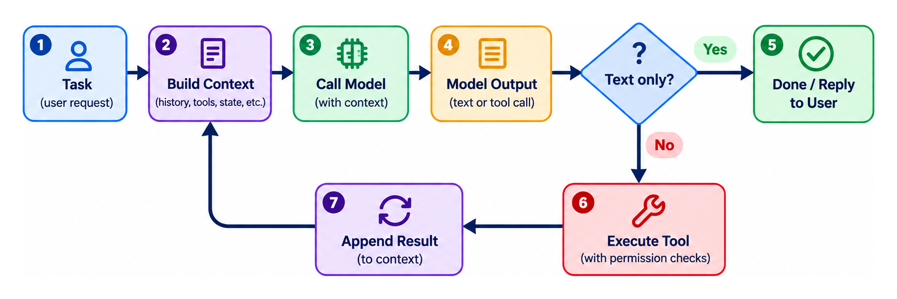

If you follow AI engineering, you've probably heard the word **"harness"** a lot lately. So much so that you start to wonder if it has turned into a buzzword. On February 11th 2026, OpenAI published *Harness engineering: leveraging Codex in an agent-first world*. It described an internal experiment: over five months, a team that started with three engineers (and later grew to seven) shipped a product beta with **no manually written code**. Codex wrote everything, about a million lines across roughly 1,500 merged pull requests. The engineers' job was to design the environment the agent worked in: the tools, documentation, feedback loops, and constraints. OpenAI said early progress was slow not because Codex lacked ability, but because that environment was underspecified. As a line from a LangChain article sums it up: **"If you're not the model, you're the harness."**

So what exactly is a harness, and why does it matter so much?

---

## What is a harness?

In simple terms: **Agent = LLM + Harness**.

A large language model on its own only takes text in and gives text out. It can't read your files, run a command, call an API, or remember what it did yesterday. The **harness** is all the software around the model that makes those things possible:

- **The loop**, which calls the model, runs the action it asks for, feeds the result back, and repeats until the task is done
- **The tools** the model can use: a shell, a file editor, a browser, your APIs (often plugged in through MCP)
- **The context**: what goes into each prompt (instructions, files, history) and what gets trimmed or summarized when it fills up
- **The memory and state** that survive between steps or sessions
- **The guardrails**: permissions, sandboxing, approvals, and budgets
- **The feedback**: tests, linters, and error messages that tell the model whether it's on track

*The loop at the heart of every harness.*

### Why it matters

The model decides *what* to do; the harness decides what it *can* do, what it *sees*, and how it *finds out it was wrong*. That is why the same model, used in two different environments, can give you two very different results.

### The types I came across

Personally, I think the best way to classify them is into these four:

- **Frameworks**: libraries for building your own harness into an application. You write the code that defines the tools, the loop, and the rules. Libraries such as LangGraph or Pydantic AI fit here.
- **Coding assistants**: ready-made harnesses that live in your terminal or editor and work on your codebase while you supervise. The best-known ones are Claude Code, Codex CLI, Cursor, etc.
- **Personal agents**: always-on assistants that act on your behalf across your everyday apps, such as email, calendar, and messaging. These became trendy at the start of this year when OpenClaw went viral (maybe they still are, but not with the same intensity). You self-host it and talk to it through apps like WhatsApp or Telegram. There are others, like Hermes Agent.
- **Workflow agents**: automations where *you* draw the path (trigger → steps → output) and the model handles some of the steps, like classifying, summarizing, or drafting. They are more predictable than an open-ended agent. The best-known one I can mention here is n8n.

There is also a mode that cuts across these families: **background/cloud agents**. You hand them a task, they work on it on their own in a separate, isolated environment (usually a cloud sandbox with a copy of your repository), and they come back with the result, often as a pull request for you to review. Examples include Codex cloud tasks and GitHub Copilot coding agent.

---

## How to choose one

Before comparing features, there are a few things to consider. Each one quickly rules options out.

### Things to consider

**1. Where can your data go?**

This is the first question to answer. Before using any AI coding agent or harness, understand where your data can go: information may be sent to the model provider (through prompts containing files, code, and command outputs), to the harness vendor itself via telemetry, error reporting, remote settings, or feature flags, and to any connected plugins or MCP servers that operate with the agent’s permissions. A notable example was the Claude Code source-map exposure, which revealed telemetry mechanisms, remote configuration calls, and feature flags. So for sensitive or regulated data, review privacy documentation, disable telemetry where possible, prefer open-source tools for transparency, and consider monitoring or restricting outbound network access to only approved model endpoints.

**2. Who is watching?** A developer watching each step needs a different setup from an agent running alone at 3 a.m. The less supervision, the stronger the guardrails need to be.

**3. What can it touch?** Read-only analysis, a single repository, or your production servers? The more damage a mistake could do, the more isolated the agent should be.

**4. Which models do you need?** Some harnesses are built around one vendor's models, while others work with any provider, including local ones. Think about today, and about the next model you'll want to switch to.

**5. How much do you want to customize?** If you want the agent to live inside your product, or you want full control over the environment such as your own tools, your own rules, and your own guardrails, frameworks are the way to go. You decide exactly what the agent can see and do. But keep in mind that this takes a lot of testing, especially if you are hosting the agent yourself. Instructions in your `AGENTS.md` or system prompt are only *suggestions* to the model, not rules it is forced to follow. If the only thing stopping your agent from deleting a folder is a line saying "please don't delete this folder," one day it might ignore it and mess up all your stuff. Anything that really matters should be enforced in code (permissions, sandboxing, approval steps), and then tested to check it actually holds.

### By use case

**Homelabbing.** You'll usually want something open-source and self-hosted that can talk to local models (through Ollama, llama.cpp, vLLM, and so on). Be realistic: small local models that chat well often struggle with multi-step tool use, so test that first. And even at home, run the agent in a container or VM. Your homelab probably holds your SSH keys and your NAS.

**Coding.** An interactive coding assistant covers most daily work. Background agents fit well-defined tasks that are easy to check, like "upgrade this dependency and make the tests pass." The best way to choose is to try a few tools on a couple of tasks you do.

**On-premises deployment.** Everything must run inside your network: the harness, the model, the tools, and the logging. This usually means a framework you can audit, connected to a model you host yourself. Check every component for outbound calls (telemetry, update checks), and pin your versions.

**Cloud deployment.** You get the strongest hosted models and less infrastructure to manage. In return, read the provider's data terms carefully (retention, training on your data, region). Also set hard spending limits: an agent that loops can burn through tokens fast.

---

## Conclusion

We talked about what a harness is, the main types you'll come across, and the questions to ask before choosing one.

Whatever you pick, remember that the rules you write in a prompt are only suggestions. The ones that really matter belong in the harness. After all, if you're not the model, you're the harness.

---

## References

- OpenAI — [*Harness engineering: leveraging Codex in an agent-first world*](https://openai.com/index/harness-engineering/), Ryan Lopopolo (Feb 11, 2026)
- LangChain — [*The Anatomy of an Agent Harness*](https://www.langchain.com/blog/the-anatomy-of-an-agent-harness), Vivek Trivedy (Mar 2026)
- The Hacker News — [*Claude Code Source Leaked via npm Packaging Error, Anthropic Confirms*](https://thehackernews.com/2026/04/claude-code-tleaked-via-npm-packaging.html) (Apr 2026)
- InfoQ — [*Claude Code source leak*](https://infoq.com/news/2026/04/claude-code-source-leak) (Apr 2026)